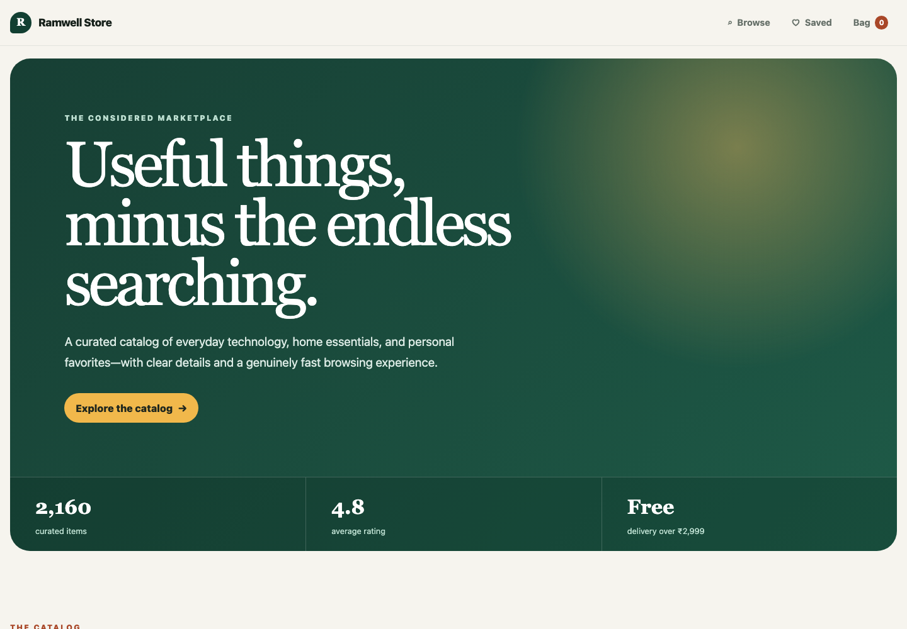
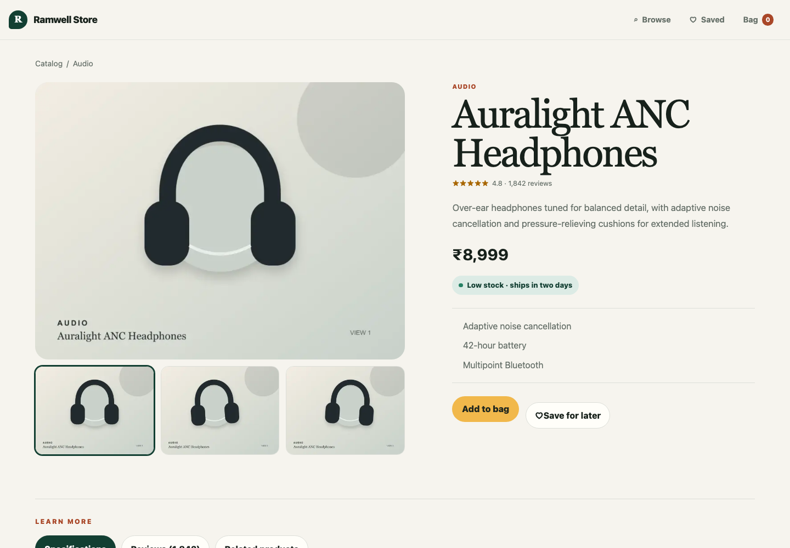

# Ramwell Store

Ramwell Store is a performance-focused e-commerce catalog built with Next.js App Router, TypeScript, and Tailwind CSS. It demonstrates production frontend patterns through an original marketplace interface rather than copying an existing brand.

## Live application

**Expected Vercel URL:** [https://ramwell-store.vercel.app](https://ramwell-store.vercel.app)

The address will become active after the `main` branch is deployed to a Vercel project named exactly `ramwell-store`. Until then, follow the local setup instructions below.

## Application preview

### Storefront



### Product details



## Highlights

- Responsive catalog with 2,160 typed product configurations built from 30 distinct product models
- Custom fixed-row virtualization with responsive column counts and overscan
- Debounced search, category filtering, sorting, and empty states
- Dynamic product routes with generated metadata and selected static params
- Optimized responsive imagery using `next/image`
- Interactive image gallery, saved-product shortlist, and working bag quantities
- End-to-end demo journey from browsing through checkout and order confirmation
- Reviews and related products code-split with `next/dynamic`
- Route-level loading, error, and not-found states
- Keyboard navigation, semantic landmarks, visible focus, live regions, and reduced-motion support

## Architecture

```text
src/
├── app/                         Routes, layouts, metadata, and route states
├── components/                  Shared site-level UI
├── features/products/
│   ├── components/              Product UI and client interactions
│   ├── data/                    Mock repository and deterministic catalog
│   └── product.types.ts         Domain types
├── features/cart/               Saved items, bag, checkout, and shared state
└── hooks/                       Reusable client hooks
```

The root catalog page is a Server Component that obtains data from a server-only repository and passes serializable product objects into a focused Client Component. Only search, filters, virtualization, gallery, and button interactions ship client JavaScript.

## Why custom virtualization?

The catalog contains hundreds of items, but the browser mounts only rows near the scroll viewport. The implementation calculates:

1. Responsive column count from viewport width
2. Total virtual row count and scroll height
3. Visible start and end rows from `scrollTop`
4. Two overscan rows above and below the viewport
5. Absolute row positions using transforms

This keeps DOM size stable as the catalog grows and makes the windowing algorithm easy to explain without hiding it behind a library.

## Shopping journey

The portfolio prototype supports a complete frontend journey:

1. Browse, search, filter, and sort the catalog
2. Save products to a dedicated shortlist
3. Add products to the bag and change quantities
4. Review delivery and order totals
5. Complete a locally validated demo checkout
6. Receive a generated order confirmation

Bag and saved-item state is intentionally client-side for this frontend learning project. Checkout does not transmit personal information or process payment. A production version would add authentication, server-side inventory and order storage, tax and shipping services, and a PCI-compliant payment provider.

## Rendering strategy

- `/` is prerendered with catalog data and hydrates only the interactive catalog experience.
- `/products/[slug]` is a dynamic route. A featured subset is generated at build time; remaining valid products render on demand.
- Product metadata is generated from the typed product record.
- Product artwork is stored locally, so the storefront remains visually reliable without third-party image requests.

## Getting started

```bash
npm install
npm run dev
```

Open [http://localhost:3000](http://localhost:3000).

## Quality checks

```bash
npm run lint
npm run build
```

## Technology

- Next.js 16 App Router
- React 19
- TypeScript
- Tailwind CSS 4
- ESLint

## Data notice

All products, prices, ratings, reviews, and availability are fictional demonstration data. The original product illustrations are local WebP assets rendered responsively through `next/image`.
